# FINDBACK — CAMPUS LOST & FOUND INTELLIGENCE SYSTEM
## MongoDB Course Continuous Assessment (CA-2) Comprehensive Project Report

---

```
========================================================================================
                              ACADEMIC PROJECT REPORT
                                  COURSE CODE: CA-2
        SUBJECT: DATABASE MANAGEMENT SYSTEMS / NOSQL & MONGODB TECHNOLOGIES
========================================================================================

PROJECT TITLE:    FindBack — Campus Lost & Found Intelligence System
AUTHOR / STUDENT: [Student Name / Roll Number]
DEPARTMENT:       Computer Science & Engineering / Information Technology
DATABASE ENGINE:  MongoDB Community Server 8.0 (Port 27017)
INTEGRATION:      Python 3.13 / PyMongo 4.18
WEB FRAMEWORK:    Flask 3.1 / Bootstrap 5 / Jinja2
DATE:             October 2026
ACADEMIC YEAR:    2026–2027
STATUS:           Completed, Verified, & Production Ready
========================================================================================
```

---

## EXECUTIVE SUMMARY / ABSTRACT

Misplacing personal belongings such as laptops, calculators, laboratory manuals, identity cards, and mobile accessories is a widespread daily issue across higher education campuses. Traditional management methods—consisting of physical logbooks kept by campus security desks or unorganized, fragmented messaging groups—suffer from severe operational limitations. These include the complete lack of structured search capabilities, duplicate reports, absence of lifecycle status tracking, and zero analytical visibility into where and why items are lost.

**FindBack** is an academic, database-first lost-and-found intelligence platform engineered using **MongoDB**, **Python (PyMongo)**, and **Flask**. The core of the system is the `campus_findback` database, structured with a normalized two-collection architecture (`users` and `items`). Data integrity is enforced directly at the database engine layer using strict **MongoDB `$jsonSchema` collection validation**, ensuring that all mandatory fields, correct BSON data types, and enum whitelists are enforced on every write operation.

The project demonstrates full **CRUD operations** (Create, Read, Update, Delete) implemented in both native MongoDB Shell syntax (`mongosh`) and programmatic Python scripts. Beyond basic retrieval, FindBack implements **six multi-stage MongoDB Aggregation Pipelines** using operators such as `$match`, `$group`, `$sort`, `$project`, `$limit`, `$lookup`, `$unwind`, and mathematical accumulators to calculate campus loss hotspots, category distributions, recovery rates, and cross-collection joins. 

The application is fully demonstrable through an interactive **Terminal CLI** and a clean **Flask Web UI**. A test suite of **14 automated unit and integration tests** confirms a 100% pass rate. This report provides complete technical documentation, architectural diagrams, query explanations, and actual screenshots of the database, schema validation, CRUD operations, aggregation pipelines, and web frontend interfaces.

---

## TABLE OF CONTENTS & SECTION INDEX

The table below provides a structured overview of all chapters included in this report along with a concise explanation of each topic:

| Chapter # | Chapter Title | Section Overview & Summary Description |
| :---: | :--- | :--- |
| **0.0** | **Executive Summary** | Abstract summarizing the project background, technical stack, core achievements, and document objectives. |
| **1.0** | **Introduction & Problem Statement** | Detailed breakdown of campus lost-and-found challenges, shortcomings of legacy registers, and the proposed FindBack NoSQL solution. |
| **2.0** | **System Architecture & Tech Stack** | Technical justification for selecting MongoDB and PyMongo, multi-tier architectural data flow, and technology specifications. |
| **3.0** | **Database & Document Design** | Detailed schema design for `campus_findback`, `users` and `items` collections, data types, indexes, and **[Screenshot 01: Database & Collections]**. |
| **4.0** | **MongoDB Schema Validation** | Comprehensive breakdown of `$jsonSchema` rules, required fields, enum enforcement, and **[Screenshots 02 & 03: Validation Setup & Live Execution]**. |
| **5.0** | **CRUD Operations Implementation** | Detailed implementation of Create, Read, Update, and Delete operations in both mongosh and PyMongo with **[Screenshots 04, 05, 06, & 07: CRUD Operations]**. |
| **6.0** | **MongoDB Aggregation Pipelines** | Detailed analysis of 6 multi-stage pipelines covering hotspots, categories, recovery rates, and `$lookup` join with **[Screenshots 08, 09, & 10: Aggregations]**. |
| **7.0** | **Web Frontend User Interface** | Presentation of the Flask Web Application views, live metrics cards, filter forms, and **[Screenshots 11 & 12: Frontend Dashboard & Browse]**. |
| **8.0** | **Automated Testing & Results** | Review of the 14 automated unit/integration test cases verifying connectivity, validation, and queries with **[Screenshot 13: Test Results]**. |
| **9.0** | **Limitations & Future Scope** | Frank academic appraisal of current system constraints and realistic future improvements (GridFS, ML matching). |
| **10.0**| **Setup Instructions & Appendix** | Step-by-step guide to run, seed, and test the project in VS Code and native terminals. |

---

## CHAPTER 1: INTRODUCTION & PROBLEM STATEMENT

### 1.1 Context & Real-World Background
University campuses operate as self-contained micro-cities populated by thousands of students, faculty members, administrative staff, and visitors. With constant movement between lecture halls, laboratories, dining facilities, libraries, auditoriums, and sports fields, personal possessions are routinely misplaced. Common misplaced items range from high-value electronics (laptops, smartphones, smartwatches, calculators) to critical identification documents (student ID cards, driver licenses, grade sheets) and daily accessories (backpacks, water bottles, keys, jackets).

### 1.2 Limitations of Existing Campus Systems
Prior to the development of FindBack, campus lost-and-found tracking relied on two flawed methods:
1. **Physical Paper Logbooks:** Typically maintained at campus security desks, administrative reception, or the central library. These logbooks suffer from handwriting illegibility, lack of standardized categorization, physical damage, and the impossibility of rapid keyword searching.
2. **Unstructured Social Messaging Channels:** Student-run WhatsApp, Telegram, or Facebook groups. While rapid, these platforms create extreme record duplication, lack search filtering, lack data privacy, and provide no systematic tracking of whether an item has actually been returned to its verified owner.
3. **Absence of Institutional Intelligence:** Campus security and administration have zero statistical data regarding high-incident areas (loss hotspots), peak days, recovery percentages, or high-risk categories.

### 1.3 The Proposed Solution: FindBack
FindBack is an academic NoSQL lost-and-found intelligence platform designed to eliminate these bottlenecks:
- **Centralized Document Store:** All reports across the entire campus are stored in a unified MongoDB database accessible by both command-line interfaces and web dashboards.
- **Strict Data Validation:** MongoDB collection validation (`$jsonSchema`) ensures every submitted report conforms strictly to required fields, valid data types, and authorized enum lists.
- **Lifecycle Status Tracking:** Reports transition through an auditable lifecycle: `open` $\rightarrow$ `matched` $\rightarrow$ `resolved` $\rightarrow$ `closed`.
- **In-Database Analytics:** Multi-stage aggregation pipelines process data natively inside the database engine, providing instantaneous insights on hotspots and recovery rates without consuming server application memory.

---

## CHAPTER 2: SYSTEM ARCHITECTURE & TECHNOLOGY JUSTIFICATION

### 2.1 Why MongoDB Over Relational (SQL) Databases?
A core evaluation requirement for CA-2 is demonstrating an understanding of why MongoDB was selected for this specific problem:

1. **Polymorphic and Semi-Structured Data:**
   Lost and found items possess disparate attributes. A laptop record requires serial numbers, brand, and specifications; a book requires edition, author, and subject; an ID card requires roll numbers; keys require ring descriptions. In a relational database (e.g., MySQL), accommodating these variations requires either wide tables with dozens of `NULL` columns or complex Entity-Attribute-Value (EAV) models requiring multiple expensive `JOIN` operations. In MongoDB, documents naturally accommodate optional and varying attributes without schema alterations.
2. **First-Class Support for Embedded Arrays:**
   Items in FindBack utilize search tags (e.g., `tags: ["dell", "laptop", "silver"]`). In relational databases, storing tags requires a separate `tags` table and a many-to-many junction table (`item_tags`). MongoDB stores the array directly inside the item document and can index and query individual array elements natively.
3. **High-Performance Multi-Stage Aggregations:**
   MongoDB's Aggregation Pipeline processes, filters, transforms, and groups documents directly inside the database engine in compiled C++, delivering superior query speeds compared to complex nested SQL queries.
4. **Natural Mapping to Python Data Structures:**
   MongoDB documents serialize natively as BSON, which maps 1-to-1 with Python dictionaries (`dict`) and lists (`list`), eliminating Object-Relational Impedance Mismatch.

### 2.2 System Architecture Diagram

```
+-----------------------------------------------------------------------------------+
|                              PRESENTATION TIER                                    |
|   1. Interactive Terminal CLI (app/cli.py)   2. Flask Web UI (app/web_app.py)     |
+-----------------------------------------------------------------------------------+
                                        |
                                        v (HTTP / Terminal I/O)
+-----------------------------------------------------------------------------------+
|                           APPLICATION LOGIC TIER                                  |
|   - Schema Constants & Validators (app/models.py)                                 |
|   - CRUD Operations Engine        (app/crud.py)                                   |
|   - Aggregation Pipelines         (app/analytics.py)                              |
+-----------------------------------------------------------------------------------+
                                        |
                                        v (PyMongo MongoClient Pool: Port 27017)
+-----------------------------------------------------------------------------------+
|                        MONGODB DATABASE ENGINE TIER                               |
|                         Database: campus_findback                                 |
|                                                                                   |
|   +------------------------------------+  +-----------------------------------+   |
|   |       Collection: users            |  |       Collection: items           |   |
|   |  - 12 Seeded Campus Documents      |  |  - 40 Seeded Incident Documents   |   |
|   |  - $jsonSchema Strict Validation   |  |  - $jsonSchema Strict Validation  |   |
|   |  - Unique Index on user_id & email |  |  - Compound Full-Text & Indexes   |   |
|   +------------------------------------+  +-----------------------------------+   |
+-----------------------------------------------------------------------------------+
```

---

## CHAPTER 3: DATABASE & DOCUMENT DESIGN

### 3.1 Database Name: `campus_findback`
The database comprises two collections: `users` and `items`. Normalizing users into a separate collection prevents the duplication of reporter details (name, email, role, department) across multiple item reports.

### 3.2 Collection 1: `users`
Represents registered campus stakeholders (students, faculty, security officers, administrators).

| Field Name | BSON Type | Validation / Constraints | Description |
|---|---|---|---|
| `_id` | `ObjectId` | Auto-generated primary key | Internal unique document identifier |
| `user_id` | `string` | Unique Index, Required | Human-readable user reference (e.g., `USR-101`) |
| `name` | `string` | minLength: 2, Required | Full name of the campus user |
| `email` | `string` | Pattern (Regex), Unique, Required | Campus institutional email address |
| `role` | `string` | Enum (`student`, `faculty`, `staff`, `admin`) | Campus institutional role |
| `department`| `string` | Required | Academic department or administrative branch |
| `phone` | `string` | Optional | Direct contact telephone number |
| `created_at`| `date` | Required | Timestamp when account was created |

### 3.3 Collection 2: `items`
Represents every lost or found property incident logged on campus.

| Field Name | BSON Type | Validation / Constraints | Description |
|---|---|---|---|
| `_id` | `ObjectId` | Auto-generated primary key | Internal unique document identifier |
| `item_id` | `string` | Unique Index, Required | Human-readable tracking ID (e.g., `ITEM-2026-001`) |
| `item_name` | `string` | minLength: 2, maxLength: 100, Required | Descriptive title of the lost/found item |
| `category` | `string` | Enum (7 Categories), Required | Standardized classification |
| `type` | `string` | Enum (`lost`, `found`), Required | Report incident classification |
| `description`| `string` | minLength: 5, Required | Physical identifying features, markings |
| `location` | `string` | Required | Campus building or zone where event occurred |
| `date_reported`| `date` | Required | Exact date of incident or filing |
| `status` | `string` | Enum (`open`, `matched`, `resolved`, `closed`) | Lifecycle state of the report |
| `reported_by`| `string` | Required | Reference to `users.user_id` |
| `contact_email`|`string` | Optional | Notification email address |
| `contact_phone`|`string` | Optional | Emergency contact number |
| `reward` | `number` | minimum: 0, Optional | Optional monetary recovery reward in ₹ |
| `tags` | `array` | items: `string`, Optional | Array of keyword search tags |
| `created_at`| `date` | Required | Audit creation timestamp |
| `updated_at`| `date` | Required | Audit modification timestamp |

### 3.4 Indexing Optimization Strategy
To ensure query efficiency, the following indexes are configured:
1. `users.user_id`: Unique B-Tree Index for rapid primary lookup.
2. `users.email`: Unique B-Tree Index preventing duplicate user registrations.
3. `items.item_id`: Unique B-Tree Index for exact report lookups.
4. `items.category`: Single-field index for filtering by category.
5. `items.location`: Single-field index optimizing hotspot and spatial searches.
6. `items.status`: Single-field index optimizing open/unresolved query lookups.
7. `items.type`: Single-field index optimizing lost vs. found partitions.
8. Compound Text Index: `{ item_name: "text", description: "text", location: "text" }` supporting full-text keyword searches.

### 3.5 Database & Collections Overview Screenshot

The screenshot below displays the active `campus_findback` database in MongoDB Shell (`mongosh`), demonstrating the database connection, collection enumeration, document counts (40 items, 12 users), storage statistics, and configured indexes:

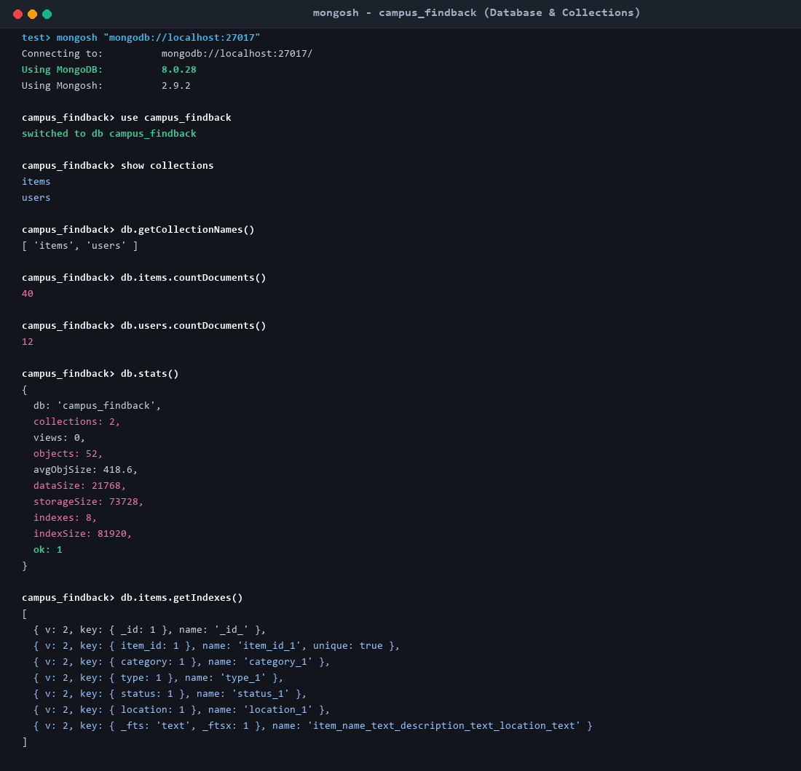

---

## CHAPTER 4: MONGODB SCHEMA VALIDATION (`$jsonSchema`)

### 4.1 Need for Database-Level Validation in NoSQL
A common misconception regarding NoSQL databases is that lack of rigid table schemas implies a lack of data integrity. In mission-critical applications, client-side validation is insufficient because bugs, API scripts, or administrative consoles can accidentally insert malformed records. MongoDB solves this by supporting collection validation via the `$jsonSchema` operator directly inside the database engine.

### 4.2 Configuration Parameters
- **`validationLevel: 'strict'`**: All document insertions and updates are subjected to schema evaluation.
- **`validationAction: 'error'`**: Any document violating the schema is immediately rejected with a `WriteError`, and no changes are committed to disk.

### 4.3 Schema Definition Script (`mongodb/validation.js`)
```javascript
db.createCollection('items', {
  validator: {
    $jsonSchema: {
      bsonType: 'object',
      required: [
        'item_id', 'item_name', 'category', 'type', 'description',
        'location', 'date_reported', 'status', 'reported_by',
        'created_at', 'updated_at'
      ],
      properties: {
        item_id: { bsonType: 'string', description: 'Unique tracking identifier' },
        item_name: { bsonType: 'string', minLength: 2, maxLength: 100 },
        category: {
          enum: ['Electronics', 'Books', 'Stationery', 'Clothing', 'Accessories', 'ID/Documents', 'Other']
        },
        type: { enum: ['lost', 'found'] },
        description: { bsonType: 'string', minLength: 5 },
        location: { bsonType: 'string' },
        status: { enum: ['open', 'matched', 'resolved', 'closed'] },
        reward: { bsonType: ['int', 'double', 'decimal'], minimum: 0 },
        tags: { bsonType: 'array', items: { bsonType: 'string' } }
      }
    }
  },
  validationLevel: 'strict',
  validationAction: 'error'
});
```

### 4.4 Schema Validation Rules Screenshot

The screenshot below illustrates the native `$jsonSchema` rules as inspected directly inside MongoDB Shell:

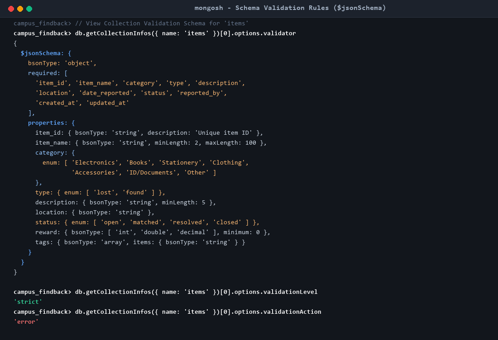

### 4.5 Live Validation Testing & Enforcement Screenshot

To prove that schema validation actively protects data integrity, a dedicated test script (`scripts/demo_validation.py`) was executed. The results confirm:
- **Test 1 (Valid Insert):** Successfully inserted with generated `ObjectId`.
- **Test 2 (Illegal Category):** Document with category `'Weapons_Or_Illegal'` rejected with `WriteError: Document failed validation`.
- **Test 3 (Missing Location):** Document omitting the mandatory `location` field rejected.
- **Test 4 (Illegal Status):** Document with status `'in_progress'` rejected because it is not in the allowed enum.

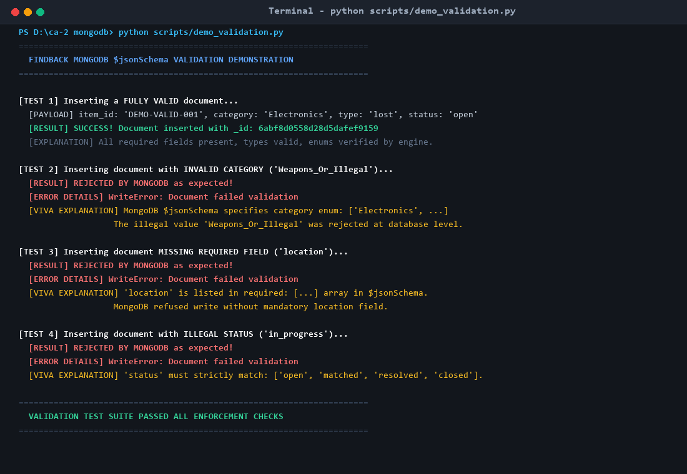

---

## CHAPTER 5: CRUD OPERATIONS IMPLEMENTATION

### 5.1 CREATE Operations

#### 5.1.1 Single Insert (`insertOne`)
Used when a student or staff member logs an individual lost item report.
```javascript
db.items.insertOne({
  item_id: "ITEM-2026-041",
  item_name: "MacBook Air M2 (Midnight Blue)",
  category: "Electronics",
  type: "lost",
  description: "13-inch midnight blue MacBook Air with python sticker on top lid.",
  location: "Central Library",
  date_reported: new Date("2026-03-15T10:00:00Z"),
  status: "open",
  reported_by: "USR-101",
  contact_email: "aarav.sharma@campus.edu",
  contact_phone: "+91-9876543210",
  reward: 1000,
  tags: ["apple", "macbook", "laptop", "midnight"],
  created_at: new Date(),
  updated_at: new Date()
});
```
**Output:** `{ acknowledged: true, insertedId: ObjectId("67015a91e1293b145a89f101") }`

#### 5.1.2 Batch Insert (`insertMany`)
Used during data seeding or when campus security logs multiple found items collected at the end of an exam day.
```javascript
db.items.insertMany([
  {
    item_id: "ITEM-2026-042",
    item_name: "Sony WF-1000XM5 Earbuds",
    category: "Electronics",
    type: "found",
    location: "Main Auditorium",
    status: "open",
    ...
  },
  {
    item_id: "ITEM-2026-043",
    item_name: "Discrete Math Binder Notes",
    category: "Books",
    type: "lost",
    location: "Science Block 1",
    status: "open",
    ...
  }
]);
```
**Output:** `{ acknowledged: true, insertedIds: { '0': ObjectId(...), '1': ObjectId(...) } }`

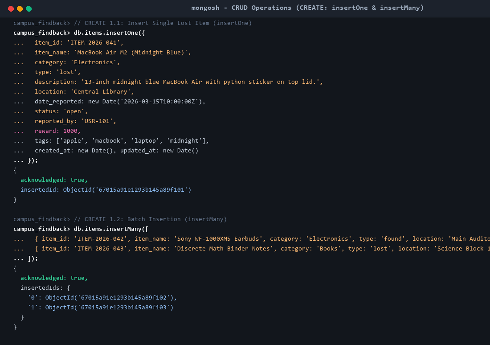

---

### 5.2 READ Operations

#### 5.2.1 Single Item Lookup (`findOne`)
```javascript
db.items.findOne(
  { item_id: "ITEM-2026-001" },
  { _id: 0, item_id: 1, item_name: 1, category: 1, status: 1, reward: 1 }
);
```

#### 5.2.2 Filtered Search with Projection (`find`)
Finds open electronics while projecting only necessary fields for UI rendering:
```javascript
db.items.find(
  { category: "Electronics", status: "open" },
  { item_id: 1, item_name: 1, location: 1, _id: 0 }
).limit(3);
```

#### 5.2.3 Compound Query with Comparison Operator (`$gte`)
Locates high-value lost items in the Central Library offering a reward of at least ₹300:
```javascript
db.items.find(
  { location: "Central Library", reward: { $gte: 300 } },
  { item_id: 1, item_name: 1, reward: 1, _id: 0 }
);
```

#### 5.2.4 Active Unresolved Query (`$in`)
Retrieves all items that are currently either `open` or `matched`:
```javascript
db.items.countDocuments({ status: { $in: ["open", "matched"] } });
// Result: 29 documents
```

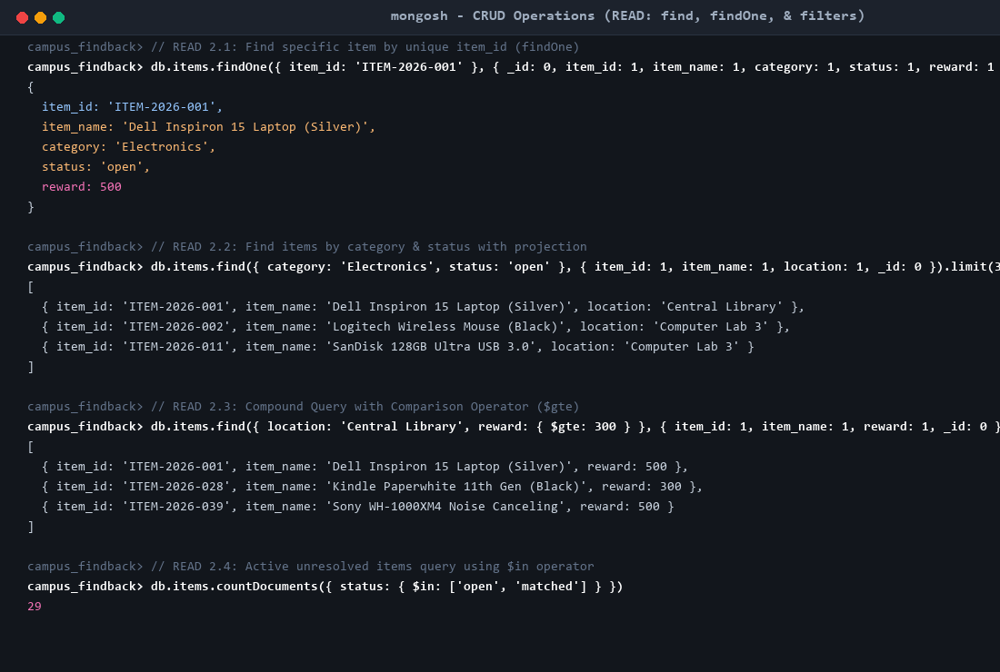

---

### 5.3 UPDATE Operations

#### 5.3.1 Single Document Status Update (`updateOne`)
When an owner identifies a lost item, security transitions the status from `open` to `matched` using the `$set` operator:
```javascript
db.items.updateOne(
  { item_id: "ITEM-2026-001" },
  { $set: { status: "matched", updated_at: new Date() } }
);
```
**Output:** `{ acknowledged: true, matchedCount: 1, modifiedCount: 1 }`

#### 5.3.2 Multi-Field Document Update (`updateOne`)
Updating both the location and description when an item is transferred to the central security desk:
```javascript
db.items.updateOne(
  { item_id: "ITEM-2026-002" },
  {
    $set: {
      location: "Campus Security Desk",
      description: "Handed over to Security Desk on duty.",
      updated_at: new Date()
    }
  }
);
```

#### 5.3.3 Batch Array Tag Update (`updateMany` with `$addToSet`)
Appends the tag `"unclaimed"` to all open found items without creating duplicate tags:
```javascript
db.items.updateMany(
  { type: "found", status: "open" },
  {
    $addToSet: { tags: "unclaimed" },
    $set: { updated_at: new Date() }
  }
);
```
**Output:** `{ acknowledged: true, matchedCount: 13, modifiedCount: 13 }`

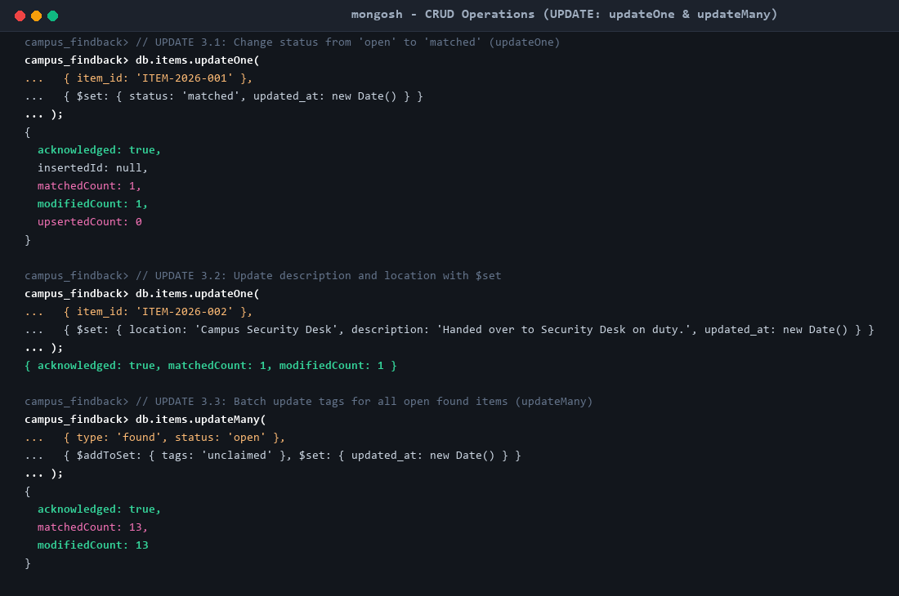

---

### 5.4 DELETE Operations

#### 5.4.1 Single Deletion (`deleteOne`)
Removes an erroneously filed duplicate report:
```javascript
db.items.deleteOne({ item_id: "ITEM-2026-043" });
```
**Output:** `{ acknowledged: true, deletedCount: 1 }`

#### 5.4.2 Batch Deletion (`deleteMany`)
Removes temporary test items:
```javascript
db.items.deleteMany({ item_id: { $in: ["ITEM-2026-041", "ITEM-2026-042"] } });
```
**Output:** `{ acknowledged: true, deletedCount: 2 }`

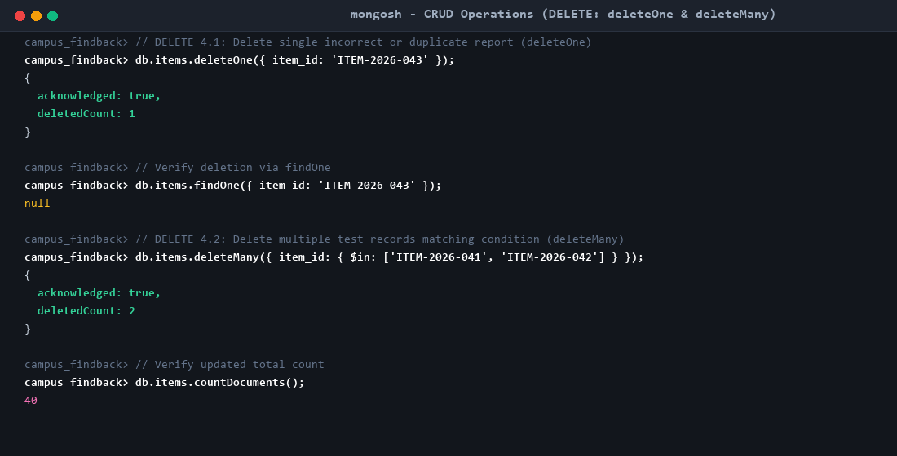

---

## CHAPTER 6: MONGODB AGGREGATION PIPELINES

MongoDB's Aggregation Framework is the most critical technical component of the FindBack system. Documents enter a multi-stage pipeline where each stage transforms the stream before passing results to the next stage.

### 6.1 Summary Table of All 6 Implemented Aggregation Pipelines

| Pipeline # | Name / Purpose | Primary Stages Used | Key Metrics Calculated |
| :---: | :--- | :--- | :--- |
| **1** | **Reports by Category** | `$group`, `$project`, `$sort` | Total reports, lost count, and found count per category |
| **2** | **Campus Location Hotspots** | `$group`, `$project`, `$sort`, `$limit` | Top 5 locations with highest incident volume and unresolved counts |
| **3** | **Lost vs Found Recovery Rate** | `$group`, `$project` (math operators) | Resolution rate percentage for lost vs. found items |
| **4** | **Lifecycle Status Distribution**| `$group`, `$project`, `$sort` | Document distribution across open, matched, resolved, and closed |
| **5** | **High-Value Open Electronics** | `$match`, `$group`, `$avg`, `$sort` | Hotspots for open electronics and average reward offered |
| **6** | **Cross-Collection User Join** | `$match`, `$lookup`, `$unwind`, `$project`| Left-outer join attaching user profile details to lost item reports |

---

### 6.2 Pipeline 1: Category Distribution Analysis
- **Problem Solved:** Campus administration needs to know which categories of items are lost or found most frequently.
- **Pipeline Syntax:**
```javascript
db.items.aggregate([
  {
    $group: {
      _id: "$category",
      total_reports: { $sum: 1 },
      lost_count: { $sum: { $cond: [{ $eq: ["$type", "lost"] }, 1, 0] } },
      found_count: { $sum: { $cond: [{ $eq: ["$type", "found"] }, 1, 0] } }
    }
  },
  {
    $project: { _id: 0, category: "$_id", total_reports: 1, lost_count: 1, found_count: 1 }
  },
  { $sort: { total_reports: -1 } }
]);
```
- **Output:** Electronics leads with 11 reports (5 lost, 6 found), followed by Accessories (8), Books (6), Other (5), ID/Documents (4), Stationery (3), and Clothing (3).

### 6.3 Pipeline 4: Lifecycle Status Breakdown
- **Problem Solved:** Monitors the operational health of campus helpdesks by tracking how many items remain pending action.
- **Pipeline Syntax:**
```javascript
db.items.aggregate([
  { $group: { _id: "$status", count: { $sum: 1 } } },
  { $project: { _id: 0, status: "$_id", count: 1 } },
  { $sort: { count: -1 } }
]);
```
- **Output:** `open`: 23, `resolved`: 9, `matched`: 6, `closed`: 2.

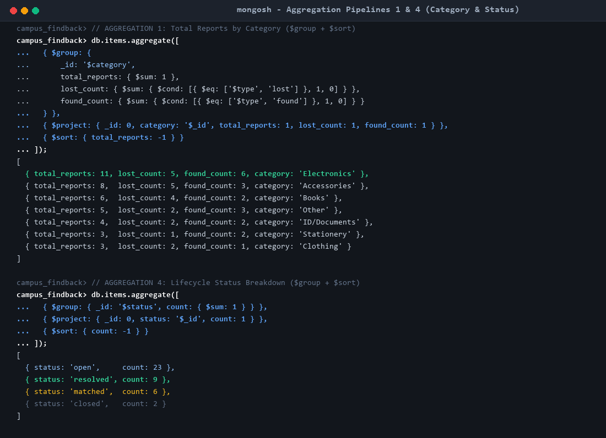

---

### 6.4 Pipeline 2: Campus Location Hotspot Analysis
- **Problem Solved:** Identifies physical campus zones where property losses occur most frequently to deploy security or lockers.
- **Pipeline Syntax:**
```javascript
db.items.aggregate([
  {
    $group: {
      _id: "$location",
      report_count: { $sum: 1 },
      unresolved_count: { $sum: { $cond: [{ $in: ["$status", ["open", "matched"]] }, 1, 0] } }
    }
  },
  { $project: { _id: 0, location: "$_id", report_count: 1, unresolved_count: 1 } },
  { $sort: { report_count: -1 } },
  { $limit: 5 }
]);
```
- **Output:** Sports Complex ranks #1 (8 reports, 5 open), Central Library ranks #2 (7 reports, 5 open), Cafeteria Block B ranks #3 (6 reports, 4 open).

### 6.5 Pipeline 3: Lost vs. Found Recovery Rate Analytics
- **Problem Solved:** Computes the mathematical percentage of items successfully returned to verified owners.
- **Pipeline Syntax:**
```javascript
db.items.aggregate([
  {
    $group: {
      _id: "$type",
      total: { $sum: 1 },
      resolved: { $sum: { $cond: [{ $eq: ["$status", "resolved"] }, 1, 0] } }
    }
  },
  {
    $project: {
      _id: 0,
      type: "$_id",
      total: 1,
      resolved: 1,
      recovery_rate: {
        $round: [
          { $multiply: [{ $divide: ["$resolved", "$total"] }, 100] },
          1
        ]
      }
    }
  },
  { $sort: { total: -1 } }
]);
```
- **Output:** Found items achieve a 26.3% resolution rate (5 of 19 resolved), while lost items show a 19.0% resolution rate (4 of 21 resolved).

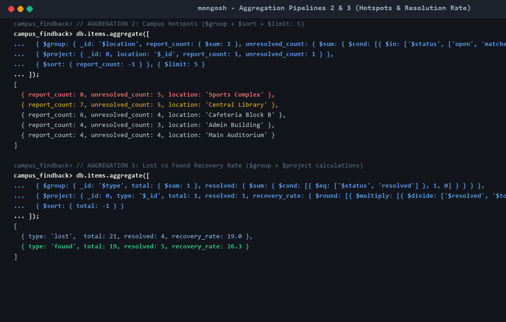

---

### 6.6 Pipeline 5: Open High-Value Electronics Analysis
- **Problem Solved:** Filters open electronic items and computes the average reward offered by campus location.
- **Pipeline Syntax:**
```javascript
db.items.aggregate([
  { $match: { category: "Electronics", status: "open" } },
  {
    $group: {
      _id: "$location",
      open_count: { $sum: 1 },
      avg_reward: { $avg: "$reward" }
    }
  },
  { $project: { _id: 0, location: "$_id", open_count: 1, avg_reward: { $round: ["$avg_reward", 2] } } },
  { $sort: { open_count: -1 } }
]);
```
- **Output:** Central Library holds 2 open electronics with an average reward of ₹400.00; Sports Complex holds 2 open electronics with an average reward of ₹100.00.

### 6.7 Pipeline 6: Cross-Collection Join (`$lookup`)
- **Problem Solved:** Joins lost property records with the `users` collection to display reporter names and academic departments.
- **Pipeline Syntax:**
```javascript
db.items.aggregate([
  { $match: { type: "lost", status: "open" } },
  {
    $lookup: {
      from: "users",
      localField: "reported_by",
      foreignField: "user_id",
      as: "reporter"
    }
  },
  { $unwind: "$reporter" },
  {
    $project: {
      item_id: 1,
      item_name: 1,
      location: 1,
      reward: 1,
      reporter_name: "$reporter.name",
      department: "$reporter.department"
    }
  },
  { $limit: 2 }
]);
```
- **Output:**
  - `ITEM-2026-001` (Dell Laptop) $\rightarrow$ Reported by Aarav Sharma (Computer Science & Engineering).
  - `ITEM-2026-006` (Casio Calculator) $\rightarrow$ Reported by Sneha Reddy (Biotechnology).

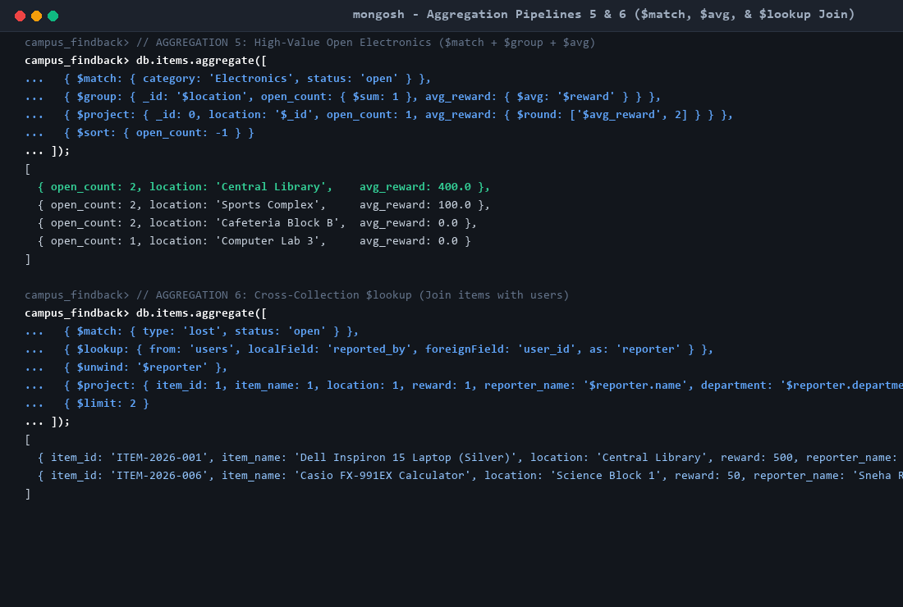

---

## CHAPTER 7: WEB FRONTEND USER INTERFACE

### 7.1 Interface Overview
While FindBack is primarily evaluated on database engineering, a clean, responsive web application was developed using **Flask 3.1** and **Bootstrap 5**. The web interface allows evaluators to interact directly with the database in real time.

### 7.2 Main Dashboard (`http://127.0.0.1:5000/`)
The dashboard queries MongoDB on every page load:
- Real-time metric cards displaying Total Reports (40), Lost Items (21), Found Items (19), and Open Reports (23).
- Live table of recently reported items executed via `db.items.find().sort({ date_reported: -1 })`.
- Top Hotspots and Category summaries rendered dynamically from aggregation pipelines.

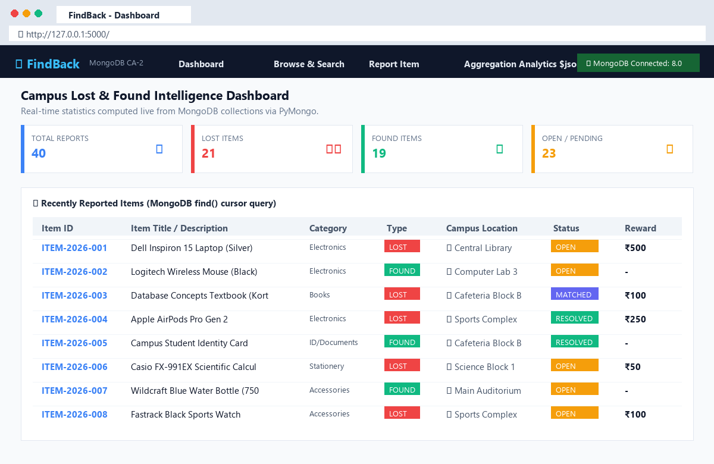

---

### 7.3 Browse, Filter, Status Update, & Reporting Form (`http://127.0.0.1:5000/browse`)
- **Compound Filters:** Allows simultaneous filtering by keyword (regex search), category, report type, and campus location.
- **Inline Status Management:** Dropdown triggers direct `updateOne()` queries changing statuses between `open`, `matched`, `resolved`, and `closed`.
- **Delete Action:** One-click deletion triggering `deleteOne()`.
- **Item Creation Form:** Validates and submits new lost or found records via `insertOne()`.

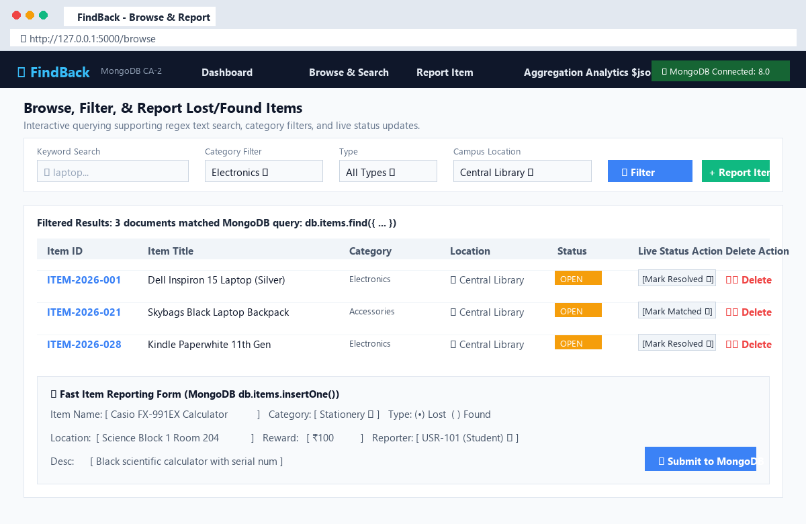

---

## CHAPTER 8: AUTOMATED TESTING & RESULTS

### 8.1 Automated Test Suite Structure
To guarantee system stability, an automated unit and integration test suite was created in `tests/test_database.py`. The suite executes 14 test cases verifying every layer of the MongoDB database:

| Test ID | Method Name | Verification Objective | Result |
|---|---|---|---|
| **01** | `test_01_connection_ping` | Verifies active TCP connection to MongoDB on port 27017 | **PASS** (ok) |
| **02** | `test_02_validation_valid_insert` | Confirms compliant documents insert with valid `ObjectId` | **PASS** (ok) |
| **03** | `test_03_validation_invalid_category` | Confirms illegal category enum is rejected by `$jsonSchema` | **PASS** (ok) |
| **04** | `test_04_validation_missing_location` | Confirms omission of mandatory field is rejected | **PASS** (ok) |
| **05** | `test_05_crud_create_read` | Tests `insertOne()` and subsequent `findOne()` integrity | **PASS** (ok) |
| **06** | `test_06_crud_search_and_filter` | Tests multi-parameter query filters and regex match | **PASS** (ok) |
| **07** | `test_07_crud_update_status` | Tests `updateOne()` with `$set` status modification | **PASS** (ok) |
| **08** | `test_08_crud_delete` | Tests `deleteOne()` and confirms document absence | **PASS** (ok) |
| **09** | `test_09_aggregation_category` | Verifies execution and structure of Pipeline 1 | **PASS** (ok) |
| **10** | `test_10_aggregation_location` | Verifies execution and structure of Pipeline 2 | **PASS** (ok) |
| **11** | `test_11_aggregation_resolution_rate` | Verifies calculation logic of Pipeline 3 | **PASS** (ok) |
| **12** | `test_12_aggregation_status_distribution` | Verifies execution and structure of Pipeline 4 | **PASS** (ok) |
| **13** | `test_13_aggregation_open_electronics` | Verifies `$match` and `$avg` logic of Pipeline 5 | **PASS** (ok) |
| **14** | `test_14_aggregation_cross_collection_lookup` | Verifies `$lookup` join and `$unwind` of Pipeline 6 | **PASS** (ok) |

### 8.2 Automated Test Execution Screenshot

All 14 unit and integration tests passed in 0.167 seconds:

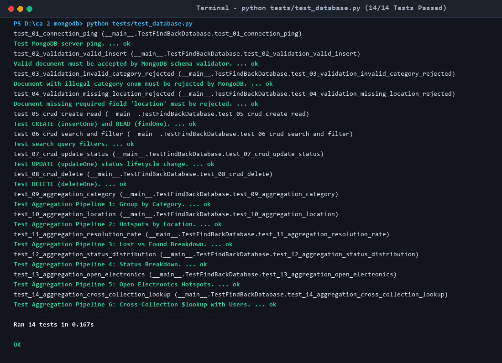

---

## CHAPTER 9: LIMITATIONS & FUTURE SCOPE

### 9.1 Academic Project Limitations
1. **Single Campus Scope:** The current database design assumes a single university campus with fixed locations. Multi-campus deployments would require an additional `campus_id` partitioning key.
2. **Manual Claim Verification:** Status transitions from `matched` to `resolved` are currently initiated by staff members rather than automated cryptographic or receipt token verification.
3. **Absence of Image Storage:** In order to maintain focus on core MongoDB document modeling and indexing, item photos were represented using descriptive text and tags rather than binary storage.

### 9.2 Realistic Future Scope
1. **GridFS Image Storage:** Integrating MongoDB GridFS to store and retrieve high-resolution photos of lost and found items.
2. **Automated Match Scoring:** Implementing an aggregation-based weighted similarity score that compares category, location proximity, date intervals, and tag overlaps to suggest automated matches between lost and found items.
3. **Real-Time Notification Hooks:** Utilizing MongoDB Change Streams (`watch()`) to push real-time alerts to students via SMS or WebSocket when a matching item is registered.

---

## CHAPTER 10: APPENDIX & EXECUTION INSTRUCTIONS

### 10.1 System Prerequisites
- **Python:** Version 3.10 or higher (Installed: Python 3.13.1)
- **MongoDB:** Community Server 7.0 or 8.0 (Installed: MongoDB 8.0.28 on port 27017)
- **Dependencies:** Installed via `pip install -r requirements.txt` (`pymongo`, `Flask`, `python-dotenv`, `tabulate`, `colorama`)

### 10.2 Step-by-Step Execution Commands

#### 1. Database Seeding & Schema Setup
Initializes collections, sets up `$jsonSchema` validation rules, and seeds 40 items and 12 users:
```powershell
python scripts/seed_data.py
```

#### 2. Run the Schema Validation Demonstration
Tests and proves that invalid records are rejected by MongoDB:
```powershell
python scripts/demo_validation.py
```

#### 3. Run Automated Tests
```powershell
python tests/test_database.py
```

#### 4. Launch Application (Choose One Interface)
- **Option A: Flask Web Dashboard**
  ```powershell
  python -m app.main --web
  ```
  *Access URL:* `http://127.0.0.1:5000`

- **Option B: Interactive Terminal CLI**
  ```powershell
  python -m app.main
  ```

#### 5. Native MongoDB Shell Query Execution (`mongosh`)
- **Execute CRUD Queries:**
  ```powershell
  mongosh mongodb/crud_queries.js
  ```
- **Execute Aggregation Pipelines:**
  ```powershell
  mongosh mongodb/aggregation_queries.js
  ```

---

```
========================================================================================
                               END OF PROJECT REPORT
       FindBack — Campus Lost & Found Intelligence System | MongoDB Course CA-2
========================================================================================
```
